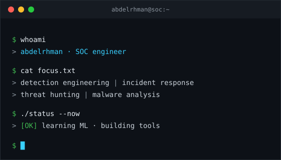
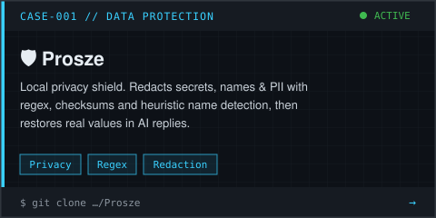
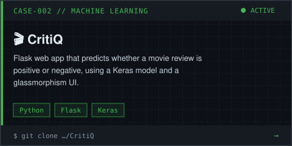
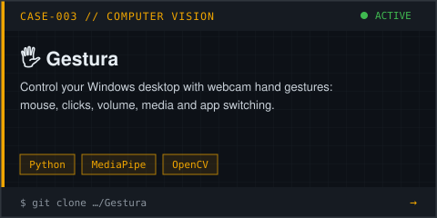
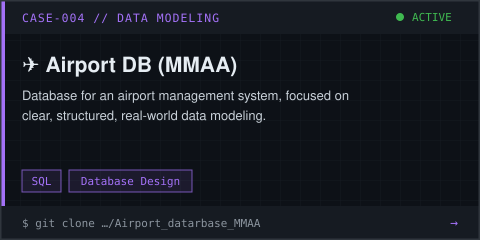

<!-- ===================== BANNER ===================== -->

<!-- ===================== HERO ===================== -->
<table>
<tr>
<td width="50%" valign="top">

<h1>🛡️ SOC Engineer</h1>

I detect, investigate, and respond to threats. I turn noisy logs into clear signals, write detections, and build tools that make the blue team faster.  
Currently learning <b>Machine Learning</b> and going deeper into <b>malware analysis</b>.

        

</td>
<td width="50%" valign="top">

</td>
</tr>
</table>

  
   
  

<!-- ===================== FOCUS ===================== -->
## 🎯 Focus Areas

<table>
<tr>
<td width="33%" valign="top"><b>🔎 Detection Engineering</b> SIEM use cases, Sigma &amp; YARA rules, tuning false positives</td>
<td width="33%" valign="top"><b>🚨 Incident Response</b> Triage, containment, forensics, and clear reporting</td>
<td width="33%" valign="top"><b>🧭 Threat Hunting</b> Hypothesis-driven hunts mapped to MITRE ATT&amp;CK</td>
</tr>
<tr>
<td valign="top"><b>🧬 Malware Analysis</b> Static and dynamic analysis (in progress)</td>
<td valign="top"><b>📊 Log &amp; Network Analysis</b> Endpoint, network, and cloud telemetry</td>
<td valign="top"><b>⚙️ Security Automation</b> Python / PowerShell playbooks and tooling</td>
</tr>
</table>

<!-- ===================== PROJECTS ===================== -->
## 🗂️ Case Files

<table>
<tr>
<td width="50%" align="center">

</td>
<td width="50%" align="center">

</td>
</tr>
<tr>
<td width="50%" align="center">

</td>
<td width="50%" align="center">

</td>
</tr>
</table>

<b>What each project does</b>

| Project | What it does | Stack |
|---|---|---|
| 🛡️ [**Prosze**](https://github.com/abdelrhmannaser845/Prosze) | Local privacy shield. Redacts secrets, names, and PII using regex rules, checksums, and heuristic name detection (no AI needed). Restores real values when an AI replies with placeholders. | Privacy · Regex |
| 🎬 [**CritiQ**](https://github.com/abdelrhmannaser845/CritiQ) | Flask app that predicts if a movie review is positive or negative, using a Keras model and a glassmorphism UI. | Python · Flask · Keras |
| 🖐️ [**Gestura**](https://github.com/abdelrhmannaser845/Gestura) | Control your Windows desktop with webcam hand gestures: mouse, clicks, volume, media, app switching. | Python · MediaPipe · OpenCV |
| ✈️ [**Airport DB (MMAA)**](https://github.com/abdelrhmannaser845/Airport_datarbase_MMAA) | Database for an airport management system, focused on clear, structured, realistic data modeling. | SQL |

<!-- ===================== TOOLKIT ===================== -->
## 🧰 Toolkit

<table>
<tr>
<th width="20%" align="left">Domain</th>
<th align="left">Tools</th>
</tr>
<tr>
<td><b>SIEM & Logging</b></td>
<td>

</td>
</tr>
<tr>
<td><b>Endpoint / EDR</b></td>
<td>

</td>
</tr>
<tr>
<td><b>Network & NDR</b></td>
<td>

</td>
</tr>
<tr>
<td><b>Threat Intel & IR</b></td>
<td>

</td>
</tr>
<tr>
<td><b>Malware Analysis</b></td>
<td>

</td>
</tr>
<tr>
<td><b>Offensive / Testing</b></td>
<td>

</td>
</tr>
<tr>
<td><b>Languages & Automation</b></td>
<td>

</td>
</tr>
<tr>
<td><b>Dev, AI & Platforms</b></td>
<td>

</td>
</tr>
</table>

<!-- ===================== ACTIVITY ===================== -->
## 📡 Activity

<table>
<tr>
<td width="50%" align="center" valign="top">

</td>
<td width="50%" align="center" valign="top">

</td>
</tr>
<tr>
<td colspan="2" align="center" valign="top">

</td>
</tr>
</table>

<h3 align="center">🐍 Contribution Graph Animation</h3>

