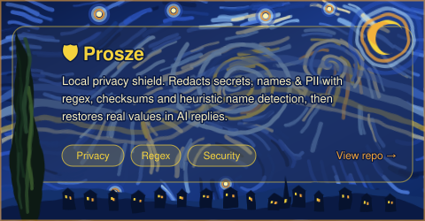
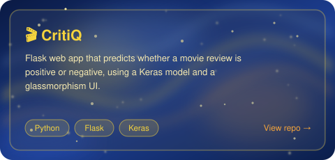
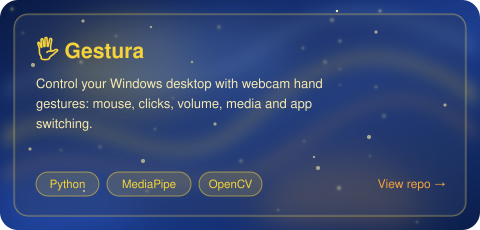
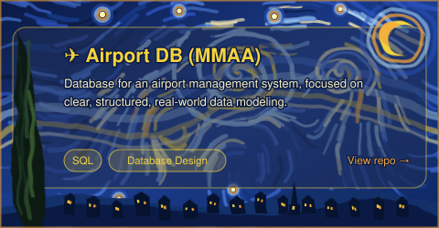

<!-- ===================== STARRY NIGHT BANNER ===================== -->


<!-- ===================== HERO ===================== -->
<table>
<tr>
<td width="50%" valign="top">

<h1>🌌 Hi, I'm Abdelrhman</h1>

<p>Software engineer who loves turning ideas into real-world tools.<br/>
Currently learning <b>Machine Learning</b> and working toward becoming a <b>malware analyst</b>.</p>

<p>
           
</p>

<a href="https://www.linkedin.com/in/abdelrhman-naser-4480a8285"></a>
<a href="mailto:abdelrhmannaser06@gmail.com"></a>

</td>
<td width="50%" valign="top">

```js
const abdelrhman = {
  role: 'Software Engineer',
  code: ['Python', 'C++', 'JavaScript', 'TypeScript'],
  askMeAbout: ['ML', 'Privacy', 'Computer Vision'],
  technologies: {
    ai:      ['TensorFlow', 'PyTorch', 'OpenCV'],
    web:     ['Flask', 'Django', 'HTML', 'CSS'],
    tools:   ['Docker', 'Git', 'Linux'],
  },
  currentlyLearning: 'Machine Learning',
  goal: 'Malware Analyst',
  funFact: 'Creating bugs since 2020 🐛',
};

// Always learning. Always building.
```

</td>
</tr>
</table>

<div align="center">
  <a href="https://git.io/typing-svg"></a>
  <br/>
  
</div>

<!-- ===================== PINNED ===================== -->
## 🌟 Pinned

<table>
<tr>
<td width="50%" align="center">
<a href="https://github.com/abdelrhmannaser845/Prosze">

</a>
</td>
<td width="50%" align="center">
<a href="https://github.com/abdelrhmannaser845/CritiQ">

</a>
</td>
</tr>
<tr>
<td width="50%" align="center">
<a href="https://github.com/abdelrhmannaser845/Gestura">

</a>
</td>
<td width="50%" align="center">
<a href="https://github.com/abdelrhmannaser845/Airport_datarbase_MMAA">

</a>
</td>
</tr>
</table>

<details>
<summary><b>What each project does</b></summary>

| Project | What it does | Stack |
|---|---|---|
| 🛡️ [**Prosze**](https://github.com/abdelrhmannaser845/Prosze) | Local privacy shield. Redacts secrets, names, and PII using regex rules, checksums, and heuristic name detection (no AI needed). Restores real values when an AI replies with placeholders. | Privacy · Regex |
| 🎬 [**CritiQ**](https://github.com/abdelrhmannaser845/CritiQ) | Flask app that predicts if a movie review is positive or negative, using a Keras model and a glassmorphism UI. | Python · Flask · Keras |
| 🖐️ [**Gestura**](https://github.com/abdelrhmannaser845/Gestura) | Control your Windows desktop with webcam hand gestures: mouse, clicks, volume, media, app switching. | Python · MediaPipe · OpenCV |
| ✈️ [**Airport DB (MMAA)**](https://github.com/abdelrhmannaser845/Airport_datarbase_MMAA) | Database for an airport management system, focused on clear, structured, realistic data modeling. | SQL |

</details>

<!-- ===================== TOOLS TABLE ===================== -->
## 🎨 Tools & Technologies

<table>
<tr>
<th width="18%" align="left">Category</th>
<th align="left">Stack</th>
</tr>
<tr>
<td><b>Languages</b></td>
<td>


</td>
</tr>
<tr>
<td><b>AI / Data</b></td>
<td>


</td>
</tr>
<tr>
<td><b>Web</b></td>
<td>


</td>
</tr>
<tr>
<td><b>Data & DevOps</b></td>
<td>


</td>
</tr>
<tr>
<td><b>Cybersecurity</b></td>
<td>


</td>
</tr>
<tr>
<td><b>Malware Analysis</b></td>
<td>


</td>
</tr>
<tr>
<td><b>Tools</b></td>
<td>


</td>
</tr>
</table>

<!-- ===================== STATS ===================== -->
## 🌙 Activity

<table>
<tr>
<td width="50%" align="center" valign="top">

</td>
<td width="50%" align="center" valign="top">
<a href="https://git.io/streak-stats"></a>
</td>
</tr>
<tr>
<td colspan="2" align="center" valign="top">

</td>
</tr>
</table>

<h3 align="center">🐍 Contribution Graph Animation</h3>


